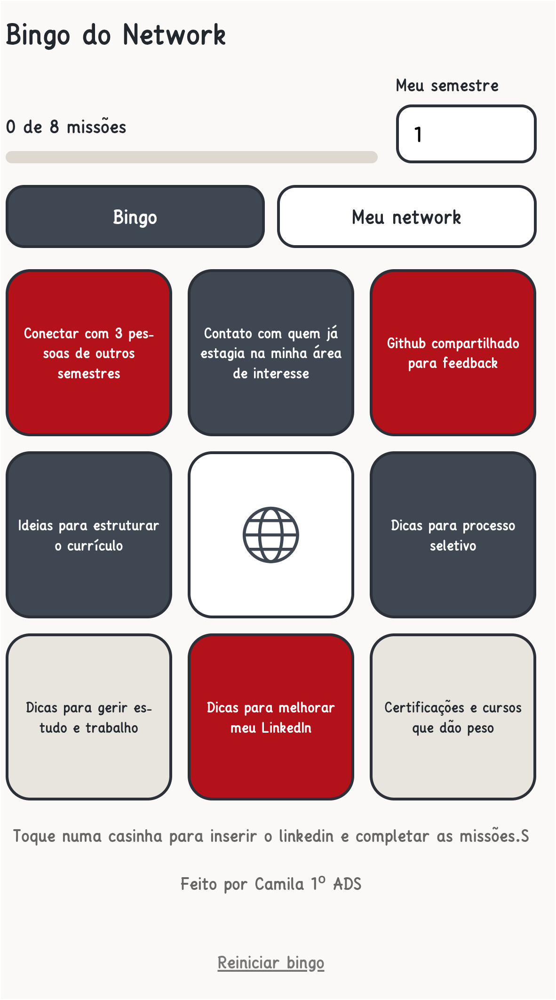
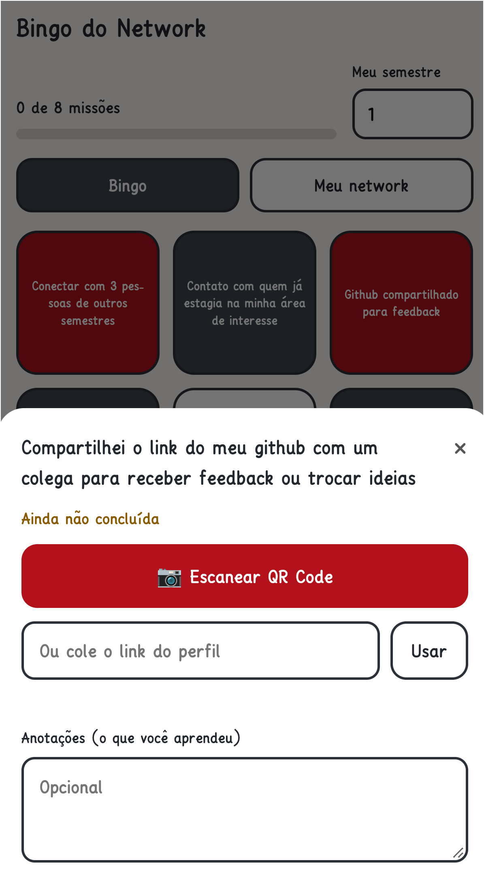
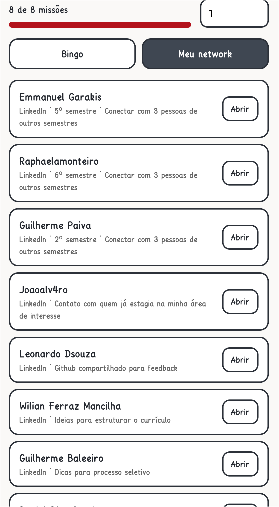
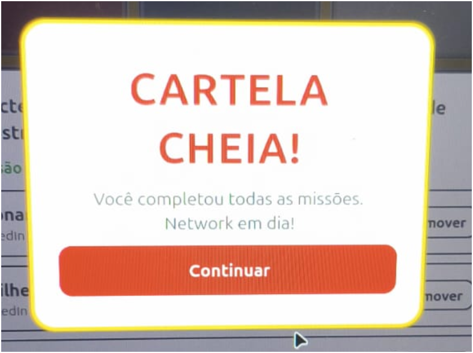
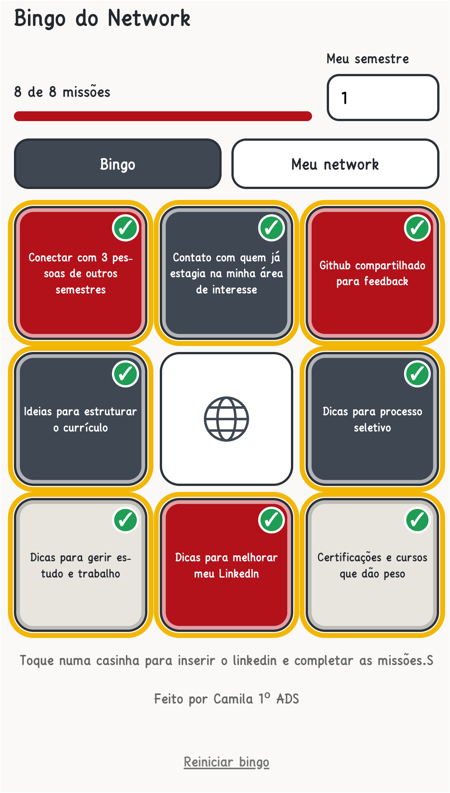

# 🎯 Bingo do Network — ADS FATEC São José dos Campos


Aplicação web interativa desenvolvida em tempo recorde para gamificar e validar o networking entre estudantes durante o **Network ADS da FATEC São José dos Campos**. O sistema substitui cartelas de papel por uma experiência digital *mobile-first* com leitura de QR Codes em tempo real diretamente pelo navegador.

🔗 **[Acesse a aplicação ao vivo](https://camilabernardis.github.io/network.fatec)**

---

## 📸 Preview da Aplicação

<p align="center">
  
  
  
</p>

<p align="center">
  
  
  
</p>

> *Telas do sistema: Painel principal da cartela, modal de input/câmera, histórico de conexões ("Meu Network") e os modais de celebração por metas alcançadas.*

---

## 📊 Impacto e Métricas de Produção

* **~100 usuários simultâneos** utilizando a aplicação ao vivo durante o evento sem quedas ou gargalos.
* **Time-to-Market de 24 horas:** Idealizado, desenvolvido, debugado e implantado na véspera do evento após identificar a necessidade de um mecanismo ágil para validar as dinâmicas propostas pela coordenação.
* **Zero fricção (No-Install):** Acesso instantâneo via link/QR Code no navegador do smartphone (Android e iOS).
* **Custo Zero de Infraestrutura:** Arquitetura 100% *client-side* hospedada no GitHub Pages com suporte nativo a **HTTPS**.

---

## 🧩 Contexto e Problema Resolvido

A dinâmica de networking por meio de bingo foi idealizada pela coordenação da FATEC (inicialmente aplicada no curso de DSM e expandida para ADS). No entanto, a menos de 24 horas do evento de ADS, a organização ainda não possuía uma ferramenta prática para **auditar e validar o cumprimento das missões** de forma rápida e escalável.

**A Solução:** Propus e construí uma aplicação web leve onde cada atividade da cartela é desbloqueada por meio de uma conexão válida e não repetida — podendo ser realizada via link do LinkedIn, WhatsApp ou leitura do QR Code específico. Isso automatizou a conferência de prêmios e eliminou completamente as filas de validação manual.

---

## ✨ Funcionalidades Principais

* 📷 **Scanner de QR Code no Navegador:** Leitura nativa de vídeo em tempo real utilizando a biblioteca `jsQR`.
* 🏆 **Motor de Regras de Premiação:**
  * **1º Prêmio (Bingo):** Validação configurada especificamente para fileiras estratégicas da cartela.
  * **Prêmio Principal (Cartela Cheia):** Disparo de alerta exclusivo somente após a conclusão de 100% das missões.
* 📝 **Histórico de Conexões ("Meu Network"):** Listagem detalhada dos perfis conectados e anotações pessoais do que foi aprendido em cada interação.
* 🎨 **UI/UX Otimizada:** Paleta de cores ajustada para legibilidade e contraste, com layout responsivo focado no uso ágil com uma mão.
* 💾 **Persistência no Cliente:** Manutenção do estado da cartela e dados salvos no navegador (`LocalStorage`) do participante durante o evento.

---

## 🛠️ Stack Tecnológica e Workflow

* **Front-end:** HTML5, CSS3, JavaScript (ES6+)
* **Processamento de Imagem / QR Code:** `jsQR.min.js` (hospedado localmente)
* **Hospedagem & Segurança:** GitHub Pages (HTTPS)
* **Engenharia Assistida por IA:** Uso estratégico de LLMs (Claude e Gemini) para aceleração de prototipagem, seguido de ciclo manual rigoroso de **debugging, refatoração de regras de negócio, ajustes de UI e testes ponta a ponta**.

---

## 🧠 Desafios Técnicos Superados (Troubleshooting)

1. **Hospedagem Local da Biblioteca (`jsQR.min.js`):** Durante os testes, dependências externas e builds padrão apresentaram instabilidade de carregamento em redes móveis de eventos. A solução foi hospedar e gerenciar o arquivo `jsQR.min.js` diretamente no repositório, garantindo estabilidade no loop de captura de frames da câmera.
2. **Acesso à Câmera em Dispositivos Móveis (HTTPS & Permissões):** Na primeira versão, a câmera falhava ao iniciar em navegadores mobile devido às políticas de segurança da API `navigator.mediaDevices.getUserMedia`. O problema foi diagnosticado e resolvido garantindo a execução em contexto seguro (HTTPS via GitHub Pages) e tratamento adequado do stream de vídeo.
3. **Resiliência em Rede de Evento:** Como redes Wi-Fi de auditórios costumam sofrer oscilação com dezenas de conexões simultâneas, toda a lógica de validação e estado foi mantida no *client-side*, garantindo resposta instantânea ao usuário sem depender de um backend dedicado.

---

## 🚀 Como Executar Localmente

1. Clone o repositório:
   ```bash
   git clone [https://github.com/camilabernardis/network.fatec.git](https://github.com/camilabernardis/network.fatec.git)

2. Acesse o diretório:
   ```bash
    cd network.fatec

3. Inicie um servidor HTTP local (obrigatório para testes de câmera):
   ```bash
    python3 -m http.server 8000

4. Abra http://localhost:8000 no navegador.

👩‍💻 Autoria

Desenvolvido por Camila Bernardis — Analista e Desenvolvedora de Sistemas (FATEC SJC)
